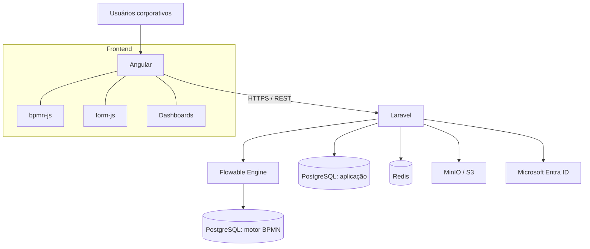

# Arquitetura técnica — Plataforma BPM e Workflow

> Proposta de arquitetura para o Software de Mapeamento e Automação de Processos (RFP).

## 1. Objetivo

Desenvolver uma plataforma corporativa BPM (Business Process Management), modular e low-code, capaz de modelar, executar e monitorar processos que envolvem diferentes áreas da empresa.

O principal desafio não é criar telas ou CRUDs, mas integrar um motor de execução BPMN, formulários dinâmicos, controle de acesso, versionamento, aprovações, devoluções, auditoria e relatórios.

A proposta aproveita Angular, TypeScript, PHP e Laravel, utilizando um motor BPMN independente em vez de implementar sua execução do zero.

### Escopo

- Modelagem visual BPMN 2.0 e processos multiárea.
- Execução de workflows, aprovações, rejeições e devoluções.
- Formulários eletrônicos configuráveis sem programação.
- Permissões por empresa, área, cargo, grupo, usuário e campo.
- Controle de prazos (SLA), notificações e auditoria.
- Relatórios configuráveis, dashboards e exportação Excel.
- Integração com ERP e sistemas corporativos.

Ficam fora do escopo inicial ERP, RPA e gestão eletrônica completa de documentos (exceto anexos de processos).

## 2. Stack tecnológica recomendada

| Camada | Tecnologia | Finalidade |
|---|---|---|
| Frontend | Angular + TypeScript | Interface e regras de apresentação |
| Componentes visuais | PrimeNG + Tailwind CSS | Componentes e estilização |
| Editor de processos | bpmn-js | Modelagem BPMN 2.0 |
| Editor de formulários | form-js | Construção e renderização de formulários |
| Backend | Laravel (PHP) | API e regras de negócio |
| Motor BPMN | Flowable Engine (Java) | Execução de workflows |
| Banco de dados | PostgreSQL | Persistência relacional e JSONB |
| Cache e filas | Redis + Laravel Horizon | Cache e processamento assíncrono |
| Tempo real | Laravel Reverb / WebSocket | Atualizações e notificações |
| Autenticação | Microsoft Entra ID + OpenID Connect | SSO e integração corporativa |
| Anexos | MinIO ou Amazon S3 | Armazenamento de objetos |
| Excel | PhpSpreadsheet | Exportação de relatórios XLSX |
| Dashboards | Apache ECharts | Indicadores e gráficos |
| Testes frontend | Playwright | Testes ponta a ponta |
| Testes backend | Pest | Testes unitários e de integração |
| Testes de carga | k6 | Validação de desempenho |
| Observabilidade | OpenTelemetry + Grafana | Telemetria e monitoramento |
| Infraestrutura | Docker + Nginx | Contêineres e proxy reverso |
| Documentação de API | Swagger / OpenAPI | Contratos e documentação REST |

## 3. Arquitetura do sistema

Recomenda-se um **monólito modular com motor BPMN independente**, evitando a complexidade prematura dos microsserviços.



### Responsabilidades

- **Angular:** modelagem visual, formulários, caixa de tarefas, administração e dashboards.
- **Laravel:** autorização, estrutura organizacional, validações, regras de negócio, relatórios, integrações e auditoria complementar.
- **Flowable:** estado e execução das instâncias, gateways, atividades, temporizadores e histórico do motor.
- **PostgreSQL:** persistência da aplicação e do motor, com bancos ou esquemas separados e acesso controlado. A aplicação não deve manipular diretamente as tabelas internas do motor.
- **Redis:** cache e filas; não substitui a persistência durável dos processos.

O Laravel se comunica com o Flowable por API REST. A integração precisa prever falhas parciais, retentativas, idempotência e reconciliação entre os estados dos dois sistemas.

## 4. Tecnologias centrais

### 4.1. bpmn-js — Editor de processos

Biblioteca JavaScript para incorporar um editor visual BPMN diretamente ao Angular.

- Editor drag and drop.
- Pools e lanes para áreas e participantes.
- Gateways, eventos de início e fim e atividades.
- Importação e exportação XML BPMN.
- Exportação SVG.
- Extensão de componentes e painel de propriedades.

O bpmn-js desenha processos, mas **não executa workflows**. Configuração das condições, validação de publicação, geração de manuais, simulação e compatibilidade com o motor exigem avaliação ou extensões adicionais. Atende potencialmente partes dos requisitos RF-01, RF-02, RF-03 e RF-06.

- [Documentação](https://bpmn.io/toolkit/bpmn-js/)
- [Demonstração online](https://demo.bpmn.io/)

### 4.2. Flowable — Motor de execução

Motor BPMN implementado em Java, com edição open source sob licença Apache 2.0 e integração via API REST. Não é necessário substituir o PHP para utilizá-lo.

Responsabilidades previstas:

- Executar instâncias e gerenciar tarefas humanas.
- Processar gateways condicionais e paralelos.
- Versionar definições de processos.
- Executar temporizadores e subprocessos.
- Manter histórico de execução.

Devoluções entre áreas, justificativas obrigatórias, alçadas, quórum, permissões e reenvio direto precisam de configuração ou desenvolvimento específico. Uma mudança arbitrária de estado não deve ser considerada equivalente a uma devolução de negócio segura sem validação do modelo e do comportamento de tarefas paralelas.

[Documentação Flowable](https://www.flowable.com/open-source/docs/)

### 4.3. form-js — Formulários dinâmicos

Biblioteca para construção visual e renderização de formulários definidos em JSON. Permite que usuários de negócio configurem telas de captura sem criar um novo componente Angular para cada processo.

Exemplo ilustrativo de definição:

```json
{
  "components": [
    {
      "key": "supplier",
      "label": "Fornecedor",
      "type": "textfield",
      "validate": { "required": true }
    },
    {
      "key": "amount",
      "label": "Valor da compra",
      "type": "number"
    }
  ]
}
```

Serão necessárias extensões ou validações próprias para CPF/CNPJ, integração com ERP, anexos, grades, regras entre campos e permissões por atividade e perfil. As regras de segurança e validação precisam ser aplicadas também no backend, independentemente do comportamento visual.

[Documentação form-js](https://bpmn.io/toolkit/form-js/)

### 4.4. PostgreSQL — Banco de dados

O PostgreSQL foi escolhido pelo suporte ao JSONB, combinado com tabelas relacionais para processos, usuários, permissões e auditoria. MySQL também é uma alternativa possível, mas a recomendação inicial é PostgreSQL.

Exemplo simplificado (não é uma migration final):

```sql
CREATE TABLE form_submissions (
    id BIGSERIAL PRIMARY KEY,
    process_instance_id BIGINT NOT NULL,
    form_version_id BIGINT NOT NULL,
    data JSONB NOT NULL,
    created_at TIMESTAMP DEFAULT NOW()
);
```

O modelo definitivo deve incluir chaves estrangeiras, índices, política de retenção, segregação de acesso e estratégia de versionamento. Cada submissão deve manter referência à versão do formulário utilizada.

## 5. Mapeamento preliminar dos requisitos

A tabela indica tecnologias candidatas, não comprovação de atendimento. Os critérios de aceite da RFP continuam sendo a referência para testes e homologação.

| Requisito | Solução proposta |
|---|---|
| RF-01 a RF-08 — Modelagem | bpmn-js + Flowable + customizações |
| RF-09 a RF-13 — Ida e volta | Flowable + regras Laravel |
| RF-14 a RF-20 — Formulários | form-js + PostgreSQL + validação backend |
| RF-21 a RF-26 — Permissões | Laravel Policies + RBAC e escopo organizacional |
| RF-27 a RF-31 — Aprovações | Flowable + Laravel |
| RF-32 a RF-33 — Excel | PhpSpreadsheet + construtor de relatórios |
| RC-01 — Caixa de tarefas | Flowable API + Angular |
| RC-02 — Notificações | Laravel Notifications |
| RC-03 — SLA | Flowable Timers + Laravel |
| RC-04 — Calendário útil | Calendário corporativo e cálculo de prazos |
| RC-05 — Auditoria | Módulo próprio com armazenamento protegido |
| RC-06 — Versionamento | Flowable + controle de versões próprio |
| RC-07 — Anexos | MinIO / S3 |
| RC-08 — Relatórios agendados | Laravel Scheduler |
| RC-09 — Dashboards | Apache ECharts |
| RC-10 — Acompanhamento visual | bpmn-js Viewer + histórico |
| RC-11 — Administração de instâncias | Flowable API + autorização e justificativa |
| RC-12 — Automações | Laravel Jobs + Flowable |
| RC-13 — Assinatura eletrônica | Integração específica a definir |
| RC-14 — Portal externo | Portal Angular + política de identidade externa |
| RC-15 — Homologação e produção | Ambientes separados + migração de modelos |
| RNF-01 — SSO e MFA | Microsoft Entra ID + OpenID Connect |
| RNF-02 — Criptografia | TLS e criptografia de armazenamento |
| RNF-03 — Sessões e senhas | Políticas de identidade e sessão |
| RNF-04 — Certificações | Evidências dos fornecedores e infraestrutura |
| RNF-05 — LGPD | Controles de acesso, retenção, anonimização e registro de acessos |
| RNF-06 — Desempenho | PostgreSQL, Redis, otimização e k6 |
| RNF-07 — Exportação em volume | Exportação otimizada e teste de desempenho |
| RNF-08 — Disponibilidade | Monitoramento, infraestrutura e SLA operacional |
| RNF-09 — Continuidade | Backups e testes de restauração |
| RNF-10 — Escalabilidade | Dimensionamento e testes de carga |
| RNF-11 — API REST | Laravel + OpenAPI |
| RNF-12 — Integração | Adaptadores ERP, Microsoft 365 e BI |
| RNF-13 — Usabilidade web | Angular, localização PT-BR e testes de navegadores |
| RNF-14 — Mobile | Angular responsivo + Playwright |
| RNF-15 — Acessibilidade | WCAG 2.1 AA e testes específicos |
| RNF-16 — Implantação | Docker e estratégia de nuvem a definir |
| RNF-17 — Suporte | Processo operacional e SLA de atendimento |
| RNF-18 — Treinamento | Documentação e capacitação em português |
| RNF-19 — Saída de dados | Exportação aberta de modelos, dados e anexos |
| RNF-20 — Licenciamento | Avaliação de dependências e custos |

> Os itens complementares e não funcionais que não estavam detalhados na recomendação anterior foram incluídos aqui como propostas preliminares. Nenhuma tecnologia, isoladamente, garante conformidade com LGPD, WCAG, SLA ou auditoria imutável.

## 6. Organização do backend

```text
app/
├── Modules/
│   ├── Identity/
│   ├── Organization/
│   ├── Process/
│   ├── Workflow/
│   ├── Form/
│   ├── Task/
│   ├── Approval/
│   ├── Permission/
│   ├── Notification/
│   ├── Report/
│   ├── Attachment/
│   ├── Audit/
│   └── Integration/
├── Infrastructure/
│   ├── Flowable/
│   ├── Storage/
│   └── Authentication/
└── Shared/
```

### Princípios de desenvolvimento

- Domain-Driven Design (DDD), aplicado de forma pragmática aos domínios mais complexos.
- SOLID e Design Patterns.
- Arquitetura orientada a eventos e Domain Events.
- Jobs assíncronos e idempotência.
- Transactional Outbox para publicação confiável de eventos após persistência local.
- Testes automatizados e observabilidade desde o início.

## 7. Flowable versus Camunda 8

| Característica | Flowable OSS | Camunda 8 |
|---|---|---|
| BPMN 2.0 | Sim, conforme elementos suportados | Sim, conforme elementos suportados |
| API REST | Sim | Sim, conforme versão e componente |
| Integração PHP | Via API | Via API |
| Licenciamento | Motor OSS Apache 2.0 | Termos específicos da edição e versão |
| Produção | Motor OSS sem licença comercial obrigatória | Verificar exigência de licença comercial |
| Infraestrutura inicial | Tendencialmente mais simples | Geralmente mais complexa |
| Plataforma customizada | Boa opção | Boa opção |

**Escolha inicial:** Flowable OSS, considerando uma plataforma interna e a intenção de manter Laravel como backend principal.

A comparação é arquitetural e preliminar. Licenças, funcionalidades e custos devem ser verificados nas versões escolhidas antes da contratação ou implantação. As edições comerciais do Flowable não estão incluídas automaticamente no motor OSS.

## 8. Roadmap de desenvolvimento

| Fase | Entregas |
|---|---|
| 1 — Fundação | Autenticação, usuários, empresas, departamentos, cargos e permissões |
| 2 — Modelagem | Editor BPMN, validação, publicação e versionamento |
| 3 — Formulários | Editor visual, campos dinâmicos, versões e validações |
| 4 — Workflow | Execução, caixa de tarefas, aprovação, rejeição e devolução |
| 5 — Gestão | SLA, notificações, anexos e auditoria |
| 6 — Relatórios | Dashboards, filtros dinâmicos e exportação Excel |
| 7 — Produção | Integração ERP, testes de carga, segurança e observabilidade |

A POC do motor deve preceder o investimento nas demais fases, para reduzir o risco de incompatibilidade com os requisitos de execução.

## 9. O que evitar inicialmente

| Tecnologia ou abordagem | Motivo |
|---|---|
| Kubernetes | Complexidade operacional prematura |
| Kafka | Redis e eventos persistentes podem atender ao cenário inicial, sujeitos a validação |
| Microsserviços | Maior custo de desenvolvimento e manutenção |
| MongoDB | PostgreSQL já contempla dados relacionais e dinâmicos |
| Motor BPMN próprio | Alto custo e risco de inconsistências na execução |
| n8n como motor principal | Não substitui integralmente um motor BPMN de processos humanos |

## 10. Prova de conceito (POC)

Implementar um processo de compras envolvendo quatro departamentos, por exemplo: Solicitante, Compras, Financeiro e Diretoria.

### Cenários de validação

- [ ] Modelar um processo com raias, atividades e gateways no bpmn-js.
- [ ] Publicar o XML e iniciar uma instância no Flowable através do Laravel.
- [ ] Criar e preencher um formulário dinâmico.
- [ ] Roteamento condicional conforme valor informado (ex.: acima de R$ 50 mil).
- [ ] Aprovar, rejeitar e devolver uma tarefa, exigindo justificativa quando aplicável.
- [ ] Devolver para uma área anterior e reenviar sem duplicar tarefas indevidamente.
- [ ] Validar acesso por área e campo, inclusive via API e exportação.
- [ ] Publicar nova versão preservando instâncias antigas.
- [ ] Verificar histórico, notificações, SLA e exportação Excel.
- [ ] Simular indisponibilidade do motor e verificar retentativas e reconciliação.

### Referências iniciais de desempenho da RFP

| Indicador | Referência |
|---|---|
| Usuários simultâneos | 200 |
| Carregamento de telas e formulários | Até 3 segundos |
| Exportação Excel | 10.000 linhas em até 60 segundos |
| Disponibilidade | 99,5% ao mês em horário comercial |
| Retenção de backup | Mínimo de 30 dias |
| RPO | Até 24 horas |
| RTO | Até 8 horas |

Esses valores são metas iniciais do documento de requisitos, e não resultados de testes. O dimensionamento depende do volume real de processos e usuários.

## 11. Links técnicos

- [Angular](https://angular.dev/)
- [Laravel](https://laravel.com/docs)
- [PrimeNG](https://primeng.org/)
- [Tailwind CSS](https://tailwindcss.com/docs)
- [bpmn-js](https://bpmn.io/toolkit/bpmn-js/)
- [form-js](https://bpmn.io/toolkit/form-js/)
- [Flowable](https://www.flowable.com/open-source/docs/)
- [PostgreSQL](https://www.postgresql.org/docs/)
- [Redis](https://redis.io/docs/)
- [PhpSpreadsheet](https://phpspreadsheet.readthedocs.io/)
- [Apache ECharts](https://echarts.apache.org/)
- [Playwright](https://playwright.dev/)
- [Pest](https://pestphp.com/)
- [k6](https://grafana.com/docs/k6/)
- [OpenTelemetry](https://opentelemetry.io/docs/)
- [Docker](https://docs.docker.com/)
- [OpenAPI](https://spec.openapis.org/oas/latest.html)

## 12. Decisões pendentes e conclusão

- [ ] Confirmar número de usuários por perfil e volume anual de instâncias.
- [ ] Definir ERP e demais integrações.
- [ ] Escolher e validar processo-piloto.
- [ ] Validar segurança, LGPD e requisitos de infraestrutura com TI.
- [ ] Verificar versões, compatibilidade e licenciamento das dependências.
- [ ] Definir estratégia de auditoria resistente a alterações e retenção de dados.
- [ ] Dimensionar equipe, orçamento e ambientes.

A stack central proposta é **Angular + Laravel + Flowable + PostgreSQL + Redis + Docker**, com **bpmn-js e form-js** para os editores low-code. A recomendação é validar primeiro a integração e os cenários de devolução, versionamento e autorização na POC, antes de iniciar a construção completa da plataforma.

---

**Fonte de requisitos:** Requisitos – Software de Mapeamento e Automação de Processos (RFP), 25/11/2026. Este documento consolida a recomendação técnica anterior e acrescenta detalhes preliminares de rastreabilidade e validação. Não constitui certificação de atendimento ou arquitetura homologada.
